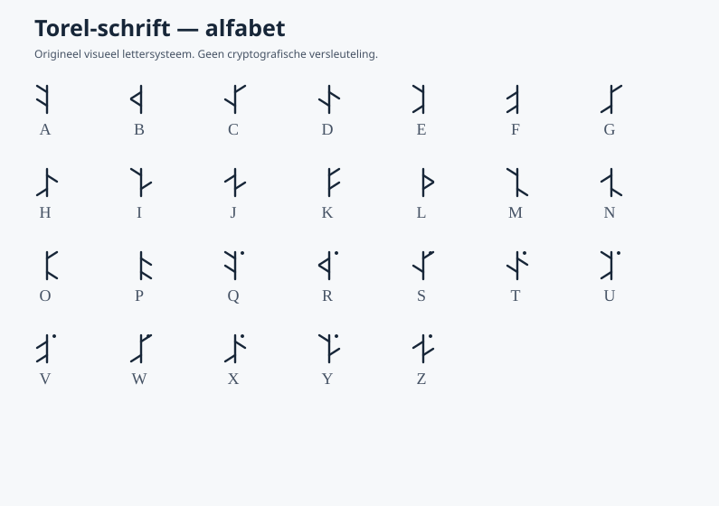

# TORELKIVA — een zelfontwikkelde geheime kunsttaal

> **Ontwikkeld door Marco Beenen in samenwerking met ChatGPT (OpenAI).**  
> Initiatief en projectleiding: **Marco Beenen**  
> Start van de ontwikkeling: **12 november 2026**  
> Projectversie: **1.1**

**Torelkiva** is een experimentele, zelfontworpen kunsttaal (*constructed language* / *conlang*) met een eigen beginnende woordenschat, grammatica en visueel schrift. Daarnaast bevat het project een afzonderlijk Python-programma voor het versleutelen en ontsleutelen van berichten.

**English:** *Torelkiva is a constructed secret language created at the initiative of Marco Beenen, developed together with ChatGPT (OpenAI), starting on 12 November 2026. It features original vocabulary, grammar, a custom writing system, and a separate encryption utility.*

## Herkomst en erkenning

Marco Beenen gaf op **12 november 2026** opdracht om een nieuwe, niet-bestaande geheime taal te ontwerpen, met een eigen naam, grammatica en schrift. Op zijn verzoek is de taal ook aangevuld met berichtversleuteling. ChatGPT hielp met het uitwerken van de taalregels, woorden, code en documentatie.

**Aanbevolen bronvermelding:**

> Torelkiva — ontwikkeld door Marco Beenen in samenwerking met ChatGPT (OpenAI), begonnen op 12 november 2026.

Deze vermelding beschrijft de samenwerking tussen een mens en AI. Ze houdt **niet** in dat OpenAI het project officieel heeft goedgekeurd, mede-eigenaar is of de herkomst heeft gecertificeerd. Zie [HERKOMST.md](HERKOMST.md) voor meer details.

## Miniwoordenboek

| Torelkiva | Nederlands |
|:--|:--|
| `vema` | hallo |
| `mi` | ik |
| `ti` | jij |
| `miva` | wij |
| `ravo` | taal |
| `sima` | geheim |
| `viro` | bericht |
| `vara` | spreken |
| `nela` | begrijpen |
| `sila` | verbergen |
| `kiri` | beschermen |
| `vo` | niet |

**Voorbeeld:** `Mi viroem sila.` = *Ik verberg het bericht.*

De standaard zinsvolgorde is **onderwerp – lijdend voorwerp – werkwoord** (SOV); voor objecten wordt `-em` gebruikt. Lees [WOORDENBOEK.md](WOORDENBOEK.md) voor de volledige versie 1.1.

## Eigen schrift



Het ontworpen Torel-schrift gebruikt eigen glyphvormen om letters visueel weer te geven. Het is **geen cryptografische beveiliging**. Een voorbeeld staat in [VOORBEELD_TOREL.svg](VOORBEELD_TOREL.svg).

## Versleuteling

De meegeleverde Python-tool gebruikt **AES-256-GCM** en wachtwoordafleiding met **scrypt**. Dit zijn bestaande cryptografische technieken, geen nieuwe zelfbedachte cipher.

Python 3.9+ en de package `cryptography` zijn vereist:

```bash
python -m pip install -r requirements.txt
python torelkiva.py versleutel
python torelkiva.py ontsleutel
```

Op Windows kan `START_WINDOWS.bat` worden gebruikt, op Linux `bash START_LINUX.sh`. Zie [LEESMIJ.md](LEESMIJ.md) voor de uitleg.

**Veiligheid:** dit hulpmiddel is niet onafhankelijk geaudit. Gebruik een lange, unieke wachtzin; zet nooit geheimen, wachtwoorden, privésleutels of privégesprekken in een openbare repository. Publiceer alleen de software, woorden en documentatie, **geen geheime berichten of hun wachtzinnen**.

## Bestanden

- `HERKOMST.md` — herkomst en ontwikkelverklaring
- `ONTWIKKELINGSVERKLARING.md` en `ONTWIKKELINGSVERKLARING.pdf` — particuliere verklaring
- `VEILIGHEID.md` — veiligheidsafspraken en beperkingen
- `CHANGELOG.md` — projectgeschiedenis
- `requirements.txt` — Python-afhankelijkheid
- `tests/test_crypto.py` — controle op encryptie/ontsleuteling
- `WOORDENBOEK.md` — grammatica, voorbeelden en miniwoordenboek
- `TOREL_ALFABET.svg`, `VOORBEELD_TOREL.svg` — voorbeelden van schrift
- `schrift.py` — Torel-schrift produceren
- `torelkiva.py` — berichten versleutelen/ontsleutelen
- `ONTWIKKELINGSVERKLARING.pdf` — gedateerde particuliere verklaring
- `LEESMIJ.md` — installatie en gebruik

## Status en rechten

Torelkiva is een beginnend creatief project. De naam en taalkenmerken zijn **niet officieel als merk geregistreerd**; een GitHub-publicatie bewijst geen exclusieve rechten of wereldwijde uniciteit. Er is momenteel **geen open-sourcelicentie toegekend** aan dit repository. Vraag de initiatiefnemer vooraf om toestemming voor hergebruik dat niet wettelijk is toegestaan. Dit is geen juridisch advies.